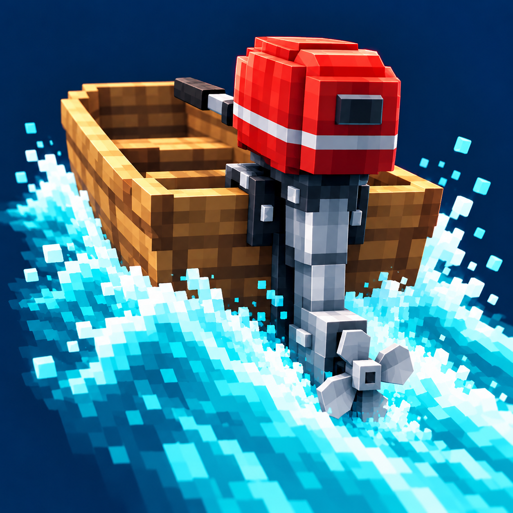
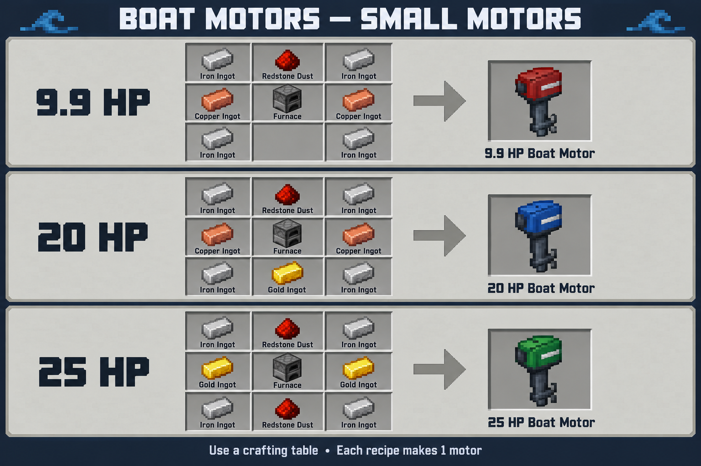
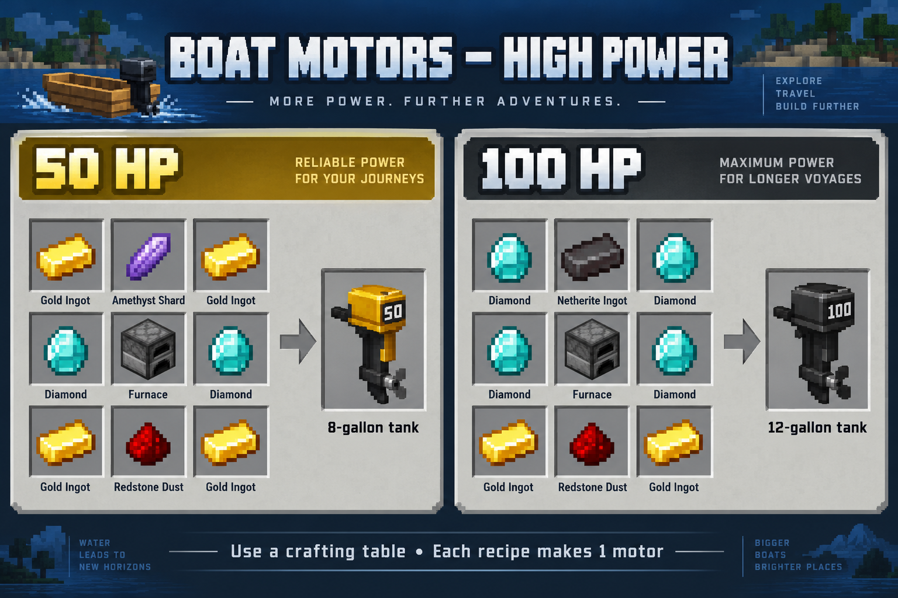
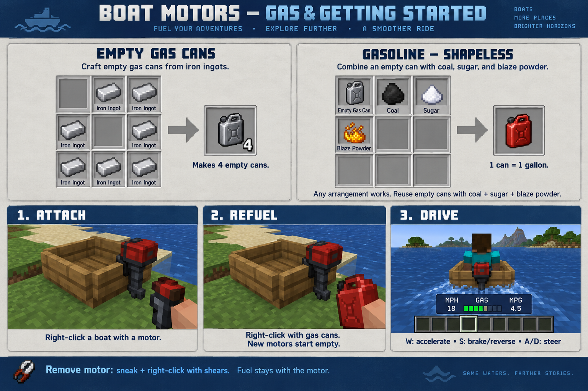

# Boat Motors



Five craftable outboard motors for Minecraft boats, with gasoline, engine sounds, and an MPH / fuel / MPG dashboard.

## Play

- Choose 9.9, 20, 25, 50, or 100 horsepower. Each has a different size, color, and detailed 3D model.
- Attach a motor by right-clicking a boat, chest boat, bamboo raft, or chest raft.
- New motors start empty. Right-click with gas cans to refuel, then board the boat.
- Use W to accelerate, S to brake or reverse, and A/D to steer.
- Sneak-right-click with shears to remove the motor. Remaining fuel stays with it.
- Adjust the engine volume with Minecraft's Friendly Creatures sound slider.
- You can still paddle when the tank is empty.

## Crafting and fuel







Combine an empty gas can, coal, sugar, and blaze powder in any arrangement to make one gallon of gasoline. Empty cans can be reused. Partly used cans retain their unused gas.

| Motor | Tank capacity |
|---|---:|
| 9.9 HP | 2.5 gallons |
| 20 HP | 4 gallons |
| 25 HP | 5 gallons |
| 50 HP | 8 gallons |
| 100 HP | 12 gallons |

The [text guide](docs/crafting-and-fuel.txt) includes every recipe and testing command. Wiki pictures are explanatory illustrations; their crafting layouts match the recipe files.

## Install

Choose the jar matching both your Minecraft version and your loader. Install the mod on the client and server for multiplayer. Use only one Boat Motors jar at a time.

Fabric and Quilt use the matching Fabric jar and require the corresponding Fabric API. Forge and NeoForge use their own native jars and do not need Fabric API. Minecraft 26.x requires Java 25; Minecraft 1.21.x requires Java 21 or newer.

The requested version range is 26.3, 26.2, 26.1.2, 26.1.1, 26.1, and 1.21.1 through 1.21.11. Forge has no official 1.21.2 release, so that combination has no jar. Consult the release manifest for individual build and validation results.

## Build from source

Install Java 25 and Java 21 JDKs. Set JAVA_HOME to Java 25. Gradle downloads the official development dependencies; Minecraft itself and third-party libraries are not included in this repository.

The canonical Fabric 26.3 project is in `boat-motors-v2`:

```powershell
cd boat-motors-v2
.\gradlew.bat build
```

Run .\gradlew.bat runGameTest to execute the server gameplay tests, including attachment, upgrades, tank refilling, fuel conservation, detachment, and fuel consumption during movement.

Generate the other Fabric projects from the canonical source:

```powershell
.\prepare-boat-ports.ps1
.\build-boat-fabric-batch.ps1 -Versions '1.21.11','1.21.1'
```

After generating the Fabric sources, create native Forge or NeoForge projects using the versions recorded in `boat-compatibility-research.json`:

```powershell
.\build-boat-native-batch.ps1 -Loader neoforge -Versions '26.3','1.21.11'
.\build-boat-native-batch.ps1 -Loader forge -Versions '26.3','1.21.11'
```

Generated projects are written to `boat-ports` and ignored by Git. The generators include the version-specific renderers, save formats, native registration, and synchronization adapters.

`improve-boat-models.py` contains the editable native cuboid models and pixel materials. It needs Pillow. `make-motor-sounds.py` synthesizes the original engine loops and needs NumPy and SoundFile; place those packages on Python's normal import path or in `python-audio`. The generated models, textures, and sounds are already included, so those tools are optional for normal builds.

## License and assets

Code and original game assets are distributed under the [MIT license](LICENSE). Engine audio is procedurally synthesized from original waveforms. The logo and wiki illustrations were generated with image_gen; wiki prompts are included in `docs/wiki/image-prompts.txt`.

This project is not an official Minecraft product and is not approved by or associated with Mojang or Microsoft.

